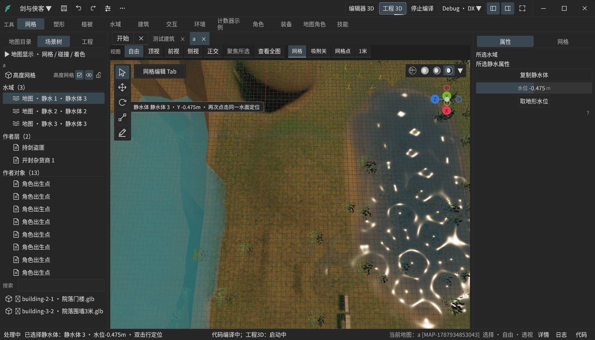
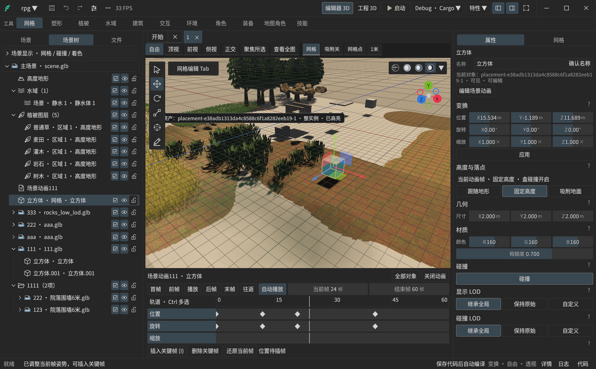
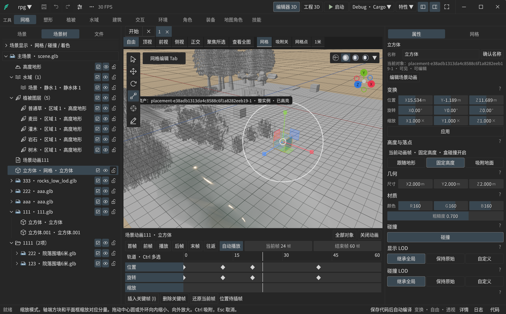
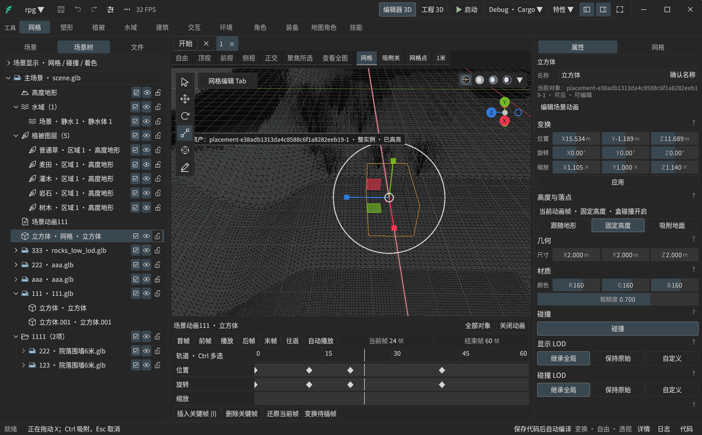
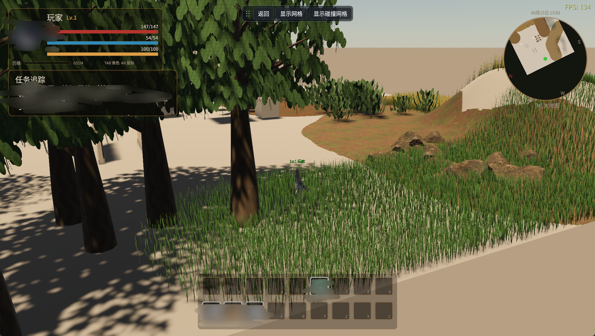
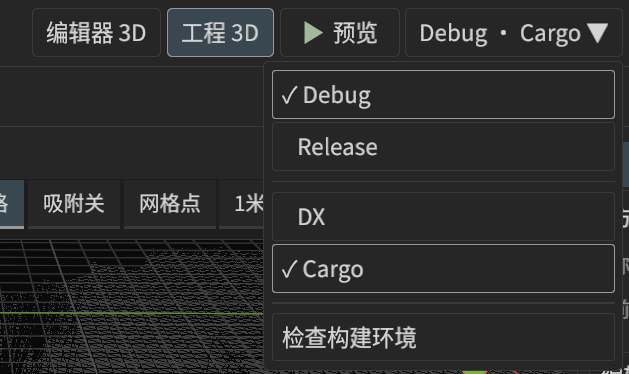
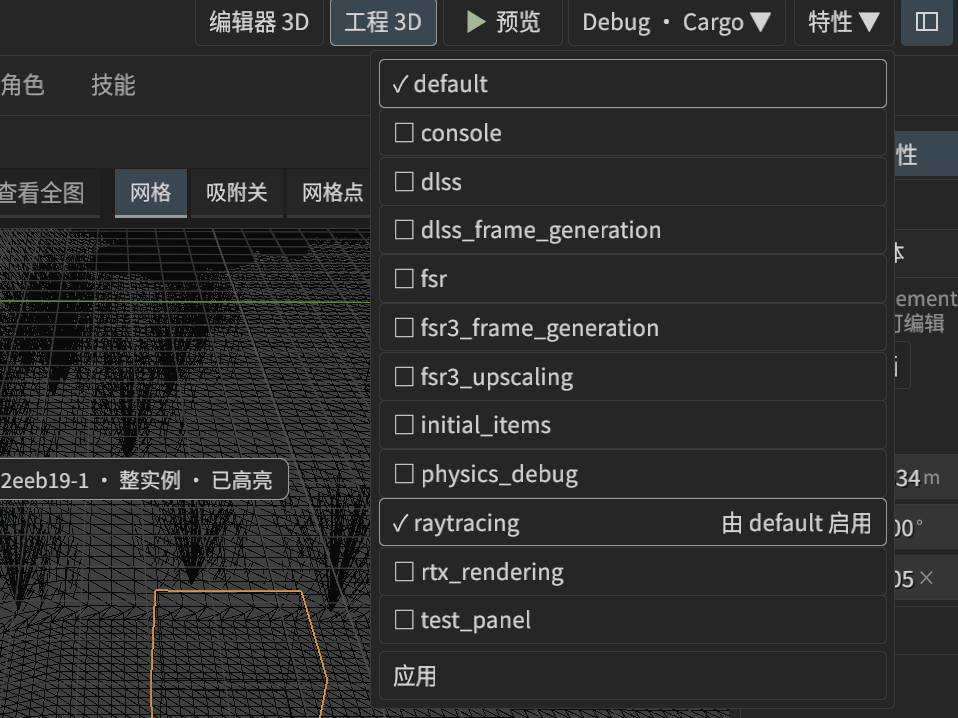

# Feathrise (羽立)

[简体中文](README.md) · **English**

**A high-performance Bevy 3D editor for large scenes and fast iteration.**

Feathrise brings scene authoring, project previews, and Rust development together in an open-source workspace for developers and content creators building 3D projects with Bevy.

[**Download the Windows Preview**](https://github.com/feathrise/feathrise/releases) · [Quick Start](#quick-start) · [Bevy Versions](#bevy-version-compatibility) · [User Guide](docs/使用说明.md)

## High-Performance Terrain, Vegetation, and Water

- **Geometry Clipmap terrain LOD.** Terrain stays detailed near the camera and uses coarser rings in the distance. Sparse height pages load on demand, and rendering and collision have separate LOD controls.
- **Local voxel terrain (preview).** Carve, fill, and smooth with 3D brushes to create caves, tunnels, and overhangs. Density data is stored in chunks, and sculpting rebuilds only the affected regions. Nearby meshes retain more detail, while distant meshes use simplified geometry.
- **GPU vegetation.** Paint grass and crops with a density brush. Grass uses GPU instancing and four levels of detail. Vegetation presets support configurable wind motion.
- **Large-scale tree and shrub placement.** Woodland instances share meshes and materials and switch detail levels with distance. Trees stay in place as the camera moves, and presets can enable collision for nearby instances.
- **Dynamic water.** Paint lakes and ponds, and use 3D splines to build rivers, rapids, and waterfalls. Surface geometry is generated in the background and uploaded in chunks. Terrain defines the shoreline for still water, while the GPU renders waves and interactive ripples.



*In the 剑与侠客 project, select a still-water body in the Scene Tree to adjust its water level in the properties panel or sample the level from the terrain.*

## Scene Authoring, Modeling, and Rigging

These features reflect the current source code.

- **Scene Tree and GLB navigation.** Select and rename placed objects in the Scene Tree. Right-click a placed model and choose **Reveal GLB File** to select its source GLB in the file window. With a project SDK that supports `scene-tree-v1`, **Project 3D** also shows a read-only hierarchy of window cameras, named lights, and objects created by the project. Each model instance appears as one item.
- **Built-in mesh editing.** Start with a cube or plane and edit vertices, edges, and faces. Extrude faces, apply linear subdivision repeatedly, undo and redo edits, and save the result with the scene.
- **Model LOD preview.** Configure rendering and collision LOD separately. Inspect the active rendering LOD, triangle wireframe, and triangle count, and compare with the original mesh from the same camera position.
- **Single-object Blender editing.** Open a built-in mesh or a complete GLB instance in your local Blender installation. On save, Feathrise uses the GLB produced by its bundled exporter to update the object in place, preserving its scene transform. You can undo the update or save it with the scene. [Blender editing guide](docs/使用说明.md#在-blender-编辑单个网格)
- **Humanoid rigging and skin weights.** Adjust joint positions on a T- or A-pose model and use a compatible skeleton from the project to generate a new skinned GLB in Feathrise or local Blender. Paint, smooth, or mirror skin weights on a skinned model. Compare how the model deforms with the original and draft weights at the same animation frame before saving a copy.

### Scene Animation

Right-click **Main Scene · scene.glb** in the Scene Tree and choose **New → Animation**. Adjust the pose at the current frame with the viewport gizmos or by entering values in the properties panel, then insert keyframes on the position, rotation, and scale tracks. A main scene GLB can store multiple clips. You can rename, duplicate, or delete clips and set them to play once, loop, or play back and forth.

**All Objects** lists the scene objects with keyframes in the current clip. A clip can animate both built-in meshes and whole instances of external GLBs. Click an object's name to open its tracks at the current frame.



*In the 剑与侠客 project, the cube is being repositioned at frame 24. The properties panel on the right shows its current pose.*

<details>
<summary>See animation editing in Solid and Wireframe modes</summary>





</details>

## Ray Tracing, DLSS, and FSR

Switch between a dynamic sky and a skybox, with separate controls for diffuse environment lighting and specular reflections.

- **Bevy Solari hybrid ray tracing.** On compatible Vulkan devices, Solari provides real-time lighting for supported terrain and static geometry and composites it with the rasterized scene.
- **NVIDIA DLSS.** Optional features enable Super Resolution, Ray Reconstruction, and 2× Frame Generation.
- **AMD FSR (experimental).** FSR 3 Upscaling and FSR 3.1 Frame Generation can be enabled independently.

The single-file Windows preview includes `raytracing`. DLSS and FSR are optional Cargo features and depend on the GPU, drivers, and vendor components. [SDK build and runtime requirements](https://github.com/feathrise/feathrise_runtime#构建与运行前提)

## Rust Development Workflow

- **Preview unsaved scene edits.** Once **Project 3D** is ready for a compatible project, preview your unsaved scene edits in the same running world. Returning to editing preserves the selection, camera, and undo history. You can also launch a saved scene separately from **Editor 3D**.
- **Build in the background when you save.** Saving source in the workspace or an external IDE triggers a build through DX (the Dioxus CLI) or directly through Cargo. Click a diagnostic to jump to its line and column. Once the build succeeds, you can choose to apply it. Model and texture changes use asset hot reloading.
- **Tune parameters while preserving runtime state.** With DX, compatible debug builds can patch the bodies of explicitly registered pure, zero-argument numeric functions in edit mode. Changes to structure or dependencies require a full rebuild. Applying that build restarts the project preview after confirmation.
- **Extend and ship your project.** Import GLB files, edit materials and animations, and load native authoring plugins in the workspace. Write project logic in Rust with the Feathrise SDK. On Windows, you can export a standalone runtime directory.

### Project 3D Preview

Once **Project 3D** is ready, click **Preview** in the top bar to **switch to the game view instantly**. Use the preview toolbar to toggle the mesh and collision mesh overlays, or click **Return** to resume editing.



### Build Configuration and Project Features

Use the top-bar build menu to choose `Debug` or `Release`, and `DX` or `Cargo`. Choose **Check Build Environment** in the same menu to see the results in the project log. The **Features** menu reads the current project's `Cargo.toml`. Select the features you want and click **Apply**. The menu indicates which features are enabled by `default`.

| Build configuration | Project Cargo features |
| --- | --- |
|  |  |

## Quick Start

1. Start the scene-based editor from source as described below, or download the single-file Windows x86_64 executable once the corresponding release is available. [GitHub Releases](https://github.com/feathrise/feathrise/releases)
2. Create a project, add a scene in the **Scenes** tab on the left, and choose **Use Current Scene as Startup Scene**.
3. Save the scene, click **Run** in **Editor 3D**, and explore the scene with the template's free camera.

You can create an empty project offline with its matching lockfile. Cargo fetches missing dependencies on the first build. Building a project requires Rust/Cargo, the MSVC build tools, and the Windows SDK.

## Bevy Version Compatibility

The current editor source and the default scene project template use Bevy 0.20.1 and the matching scene SDK.

| Bevy version | Feathrise editor version | `feathrise_runtime` SDK |
| --- | --- | --- |
| [0.20.1](https://crates.io/crates/bevy/0.20.1) | [0.3.0-preview.1](https://github.com/feathrise/feathrise/releases/tag/0.3.0-preview.1) | [Pinned GitHub commit fb5efca](https://github.com/feathrise/feathrise_runtime/tree/fb5efcabc23b4a48b42e7b7df23e9e63d328eb71) |
| [0.20.1](https://crates.io/crates/bevy/0.20.1) | [0.2.0-preview.1](https://github.com/feathrise/feathrise/releases/tag/0.2.0-preview.1) | [0.2.0](https://crates.io/crates/feathrise_runtime/0.2.0) · [GitHub Release](https://github.com/feathrise/feathrise_runtime/releases/tag/0.2.0) |
| [0.19.1](https://crates.io/crates/bevy/0.19.1) | [0.1.0-preview.2](https://github.com/feathrise/feathrise/releases/tag/0.1.0-preview.2), [0.1.0-preview.1](https://github.com/feathrise/feathrise/releases/tag/0.1.0-preview.1) | [0.1.0](https://crates.io/crates/feathrise_runtime/0.1.0) |

Source builds default to the embedded configuration and lockfile for pinned public Git revisions. Cargo fetches the SDK and patches on the first build. Use the editor and SDK that match the format of older projects. [SDK sources](docs/使用说明.md#sdk-来源)

## Run from Source

Install Rust/Cargo 1.97.1 or later. On Windows, install the MSVC x64/x86 build tools and the Windows SDK as well. The build uses `rust-lld` from the Rust toolchain as its linker.

Clone the editor repository from GitHub to work on the editor and its bundled template. Cargo fetches the locked public SDK and patches on the first build.

```powershell
git clone https://github.com/feathrise/feathrise.git
Set-Location feathrise
cargo check --locked -p feathrise_host
cargo run --locked
```

The [empty project template](templates/empty) is a standalone Cargo project. Check it directly from the public checkout with the following command.

```powershell
cargo check --locked --manifest-path templates/empty/Cargo.toml --target-dir target
```

The editor reads this template directly when built from source. New projects get their own Cargo lockfile by default and fetch missing dependencies on the first build.

### Local Development Across Repositories

Place the editor, the matching Bevy 0.20.1 SDK, and the patches checkout under the same parent directory.

```text
feathrise/
feathrise_runtime/
feathrise_patches/
```

To work on all three together, clone the [SDK](https://github.com/feathrise/feathrise_runtime) and [patches](https://github.com/feathrise/feathrise_patches) repositories from GitHub. In `feathrise/`, copy the example configurations and resolve the local dependencies.

```powershell
Copy-Item .cargo/local-sdk.example.toml .cargo/local-dev.toml
Copy-Item sdk-source.local.example.toml sdk-source.toml
cargo fetch
cargo run --locked
```

`.cargo/local-dev.toml` selects the separate `.local/sdk/Cargo.lock` for the local SDK. Cargo commands and IDEs use this lockfile for local development. The root `Cargo.lock` pins the public Git dependencies. `sdk-source.toml` selects the dependency source for newly created projects. [Local configuration migration](docs/开发与验收.md#本地源码覆盖) · [Windows CI](docs/ci.md) · [SDK sources](docs/使用说明.md#sdk-来源)

The development build produces `target/debug/feathrise.exe` from the `feathrise_host` Cargo package. Users can run a prebuilt editor. Building a project requires the Rust/Cargo toolchain used by that project.

The public source ships without the official Feathrise logo. The default build requires no branding assets. To build with branding assets you have permission to use, see [optional custom branding](docs/开发与验收.md#可选自有品牌构建).

## User and Developer Documentation

- Dual-mode viewport, project execution and export, SDK sources, and asset locations. [User Guide](docs/使用说明.md)
- Single-file plugins, global and per-project installation, and the authoring ABI. [Authoring Plugins](docs/作者插件.md)
- Dependency configuration, project-independent regression checks, and optional external validation adapters. [Development and Validation](docs/开发与验收.md)
- Pinned SDK revision and checks for default and `validation` builds. [Windows CI](docs/ci.md)

## Repository Layout

```text
src/                Host, project management, authoring setup, and runtime process lifecycle
crates/             Authoring tools, plugin API, and project management libraries
assets/             Embedded tool icons and proxy linker source
templates/empty/    Empty project source, Cargo manifest, and lockfile
build/              Runtime resource manifests
tests/fixtures/     Project-independent test assets
docs/               User, development, and CI documentation
```

`build.rs` and `build/` are build inputs. The editor repository tracks `Cargo.lock` and ignores the `target/` build cache, `.local/` validation artifacts, and machine-local dependency overrides.

First-party source code, tool icons, and test assets are dual-licensed under [MIT](LICENSE-MIT) or [Apache-2.0](LICENSE-APACHE), at your option. The official Feathrise logo has separate branding terms. [Branding terms and third-party notices](THIRD_PARTY_NOTICES.md)
