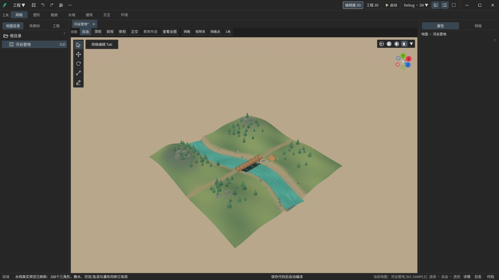
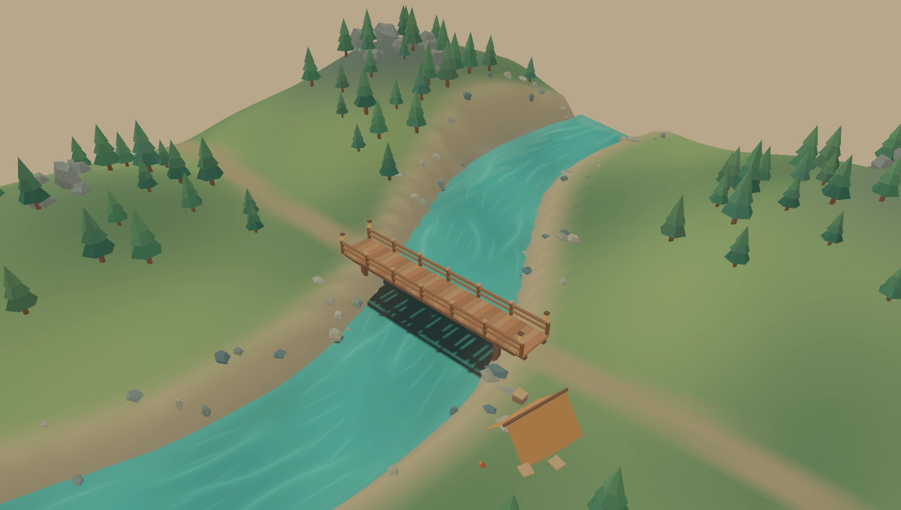
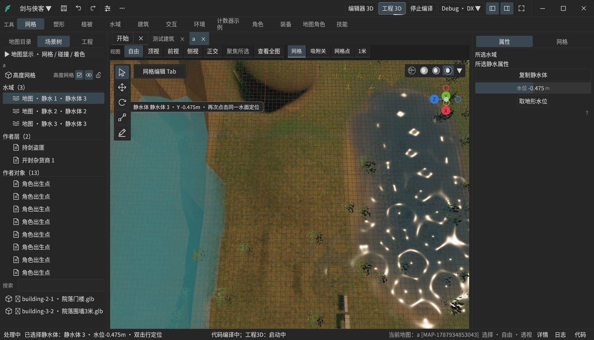

# Feathrise（羽立）

**简体中文** · [English](README.en.md)

**面向大场景与快速迭代的高性能 Bevy 3D 编辑器。**

Feathrise（羽立）把场景制作、工程预览和 Rust 开发放进同一个开源工作台，面向用 Bevy 构建 3D 工程的开发者和内容作者。

[**下载 Windows 预览版**](https://github.com/feathrise/feathrise/releases) · [快速开始](#快速开始) · [Bevy 版本](#bevy-版本对应表) · [使用说明](docs/使用说明.md)



*河谷营地演示工程的工作台实拍，展示地形、林带、样条河流和模型摆放。*

## 高性能地形、植被与水域

- **Geometry Clipmap 地形 LOD。** 相机附近保留精细地形，远处使用更粗的环带。稀疏高度页按需加载，显示与碰撞可分别设置 LOD。
- **局部体素地形（预览）。** 用三维笔刷挖掘、填充和平滑，制作洞穴、洞道与悬挑地形。密度数据分块存储，雕刻后只重建受影响的区域，近处显示精细网格，远处使用简化网格。
- **GPU 植被。** 用密度笔刷绘制草地和作物。草叶采用 GPU 实例化和四级 LOD，植被预设可配置随风摆动。
- **大规模树木与灌木。** 林带实例共享网格和材质，按距离切换模型细节。树位随相机移动保持稳定，近处实例可按预设启用碰撞。
- **动态水域。** 刷绘湖泊和池塘，用三维样条制作河流、急流和瀑布。水面几何在后台生成并分块上传，静水按地形裁出岸线，GPU 渲染波浪和交互波纹。



*同一座木桥在工程运行时的画面。* [观看 12 秒场景短片](docs/media/riverbend-tour.webp)



*《剑与侠客》工程实拍。可从场景树选中静水，在属性面板调整水位或从地形取水位。*

## 场景制作、建模与角色

以下功能对应当前源码。

- **场景树与 GLB 定位。** 在场景树切换对象、重命名摆放物，右键可在文件窗口定位源 GLB。「工程 3D」使用支持 `scene-tree-v1` 的工程 SDK 时，还可查看只读的窗口相机、命名灯光和工程对象，模型实例按整件显示。
- **内置网格编辑。** 从立方体或平面开始编辑点、边、面，支持挤出、连续线性细分、撤销重做与场景保存。
- **模型 LOD 预览。** 分别设置显示与碰撞 LOD，查看当前显示档位、三角线和面数，也可在同一机位对照原始网格。
- **Blender 单对象编辑。** 直接用 Blender 精细编辑场景模型，保存后即可在 Feathrise 原位看到更新，让建模与场景摆放快速衔接。[操作说明](docs/使用说明.md#在-blender-编辑单个网格)
- **人形绑骨与蒙皮权重。** 校正 T/A 姿态模型的关节点，参考工程内的兼容骨架，由编辑器或本机 Blender 生成带蒙皮的新 GLB。对已蒙皮模型可刷权重、平滑和镜像，在同一动作帧对照原始与草稿后另存。

## 光追、DLSS 与 FSR

场景可切换动态天空和天空盒，并分别调整漫反射补光和镜面反射强度。

- **Bevy Solari 混合光追。** 在兼容的 Vulkan 设备上，为接入的地形和静态几何提供实时光照，并与光栅画面合成。
- **NVIDIA DLSS。** 通过可选特性接入超分辨率、光线重建（Ray Reconstruction）和 2× 帧生成。
- **AMD FSR（实验）。** FSR 3 超分辨率与 FSR 3.1 帧生成可分别启用。

Windows 单文件预览版编入 `raytracing`。DLSS 与 FSR 通过 Cargo 特性按需构建，实际可用性取决于显卡、驱动和对应的厂商组件。 [SDK 构建与运行条件](https://github.com/feathrise/feathrise_runtime#构建与运行前提)

## 更高效的 Rust 开发方式

- **编辑草稿，直接预览。** 兼容工程的「工程 3D」就绪后，可在同一运行世界预览当前未保存的场景改动。返回编辑时保留选择、相机和撤销历史。已保存的场景也可以从「编辑器 3D」独立启动。
- **保存源码，后台编译。** 在工作台或外部 IDE 保存代码后，由 DX（Dioxus CLI）或原生 Cargo 构建。点击诊断可跳转到源码行列，构建成功后由开发者确认应用新版本。模型和贴图改动走资源热重载。
- **保留运行状态调参数。** 兼容的 Debug 工程使用 DX 时，可在编辑态为显式登记的无参纯数值函数应用函数体补丁，保留当前运行状态。结构或依赖改动走完整构建，确认应用后重启工程预览。
- **扩展和交付自己的工程。** 在工作台导入 GLB、编辑材质和动画，按需加载原生作者插件。工程逻辑使用 Rust 和 Feathrise SDK 编写，Windows 下可导出独立运行目录。

## 快速开始

1. 按下文启动场景版源码，或在对应版本发布后获取 Windows x86_64 单文件 EXE。 [GitHub Releases](https://github.com/feathrise/feathrise/releases)
2. 新建工程，在左侧「场景」页创建一个场景，然后使用「当前场景设为启动场景」。
3. 保存场景，在「编辑器 3D」点击「启动」，用模板提供的自由相机查看场景。

新建工程从空内容开始并直接写入配套锁文件，无需联网。首次构建时 Cargo 获取缺少的依赖。编译工程需要 Rust/Cargo、MSVC 构建工具与 Windows SDK。

## Bevy 版本对应表

当前编辑器源码和默认新建的场景工程使用 Bevy 0.20.1 与配套场景 SDK。下表列出已发布版本的兼容关系。

| Bevy 版本 | Feathrise 编辑器版本 | `feathrise_runtime` SDK |
| --- | --- | --- |
| [0.20.1](https://crates.io/crates/bevy/0.20.1) | [0.2.0-preview.1](https://github.com/feathrise/feathrise/releases/tag/0.2.0-preview.1) | [0.2.0](https://crates.io/crates/feathrise_runtime/0.2.0) · [GitHub Release](https://github.com/feathrise/feathrise_runtime/releases/tag/0.2.0) |
| [0.19.1](https://crates.io/crates/bevy/0.19.1) | [0.1.0-preview.2](https://github.com/feathrise/feathrise/releases/tag/0.1.0-preview.2)、[0.1.0-preview.1](https://github.com/feathrise/feathrise/releases/tag/0.1.0-preview.1) | [0.1.0](https://crates.io/crates/feathrise_runtime/0.1.0) |

源码构建默认使用内嵌的公开 Git 固定提交配方和锁，首次编译时由 Cargo 获取 SDK 和补丁。旧版工程使用与自身格式对应的编辑器和 SDK。[SDK 来源](docs/使用说明.md#sdk-来源)

## 从源码启动

需要 Rust/Cargo 1.97.1 或更高版本，Windows 还需要 MSVC x64/x86 工具与 Windows SDK。链接器使用 Rust 工具链中的 `rust-lld`。

从 GitHub 检出编辑器仓库即可开发编辑器及随仓模板。第一次需要 Cargo 获取锁定的公开 SDK 和补丁。

```powershell
git clone https://github.com/feathrise/feathrise.git
Set-Location feathrise
cargo check --locked -p feathrise_host
cargo run --locked
```

[空工程模板](templates/empty) 是独立的 Cargo 工程，公开检出可直接检查：

```powershell
cargo check --locked --manifest-path templates/empty/Cargo.toml --target-dir target
```

源码版直接读取这份模板。默认新建工程带自己的 Cargo 锁，首次构建获取缺少的依赖。

### 本地源码联调

将当前编辑器和配套的 Bevy 0.20.1 SDK、补丁工作树放在同一父目录。

```text
feathrise/
feathrise_runtime/
feathrise_patches/
```

从公开 GitHub 分别克隆 [SDK](https://github.com/feathrise/feathrise_runtime) 和 [补丁](https://github.com/feathrise/feathrise_patches)，可一并修改。进入 `feathrise/`，复制示例并重新解析本地依赖。

```powershell
Copy-Item .cargo/local-sdk.example.toml .cargo/local-dev.toml
Copy-Item sdk-source.local.example.toml sdk-source.toml
cargo fetch
cargo run --locked
```

`.cargo/local-dev.toml` 为本地 SDK 启用独立锁 `.local/sdk/Cargo.lock`。普通 Cargo 命令和 IDE 都会读取它，仓库根目录的 `Cargo.lock` 继续锁定公开 Git 来源。`sdk-source.toml` 单独控制新建工程来源。已有联调配置的迁移方式见[开发与验收](docs/开发与验收.md#本地源码覆盖)。 [Windows CI](docs/ci.md) · [SDK 来源](docs/使用说明.md#sdk-来源)

开发产物为 `target/debug/feathrise.exe`，内部 Cargo 包名为 `feathrise_host`。普通用户可使用编译好的编辑器，构建工程需要工程所用的 Rust/Cargo 环境。

当前公开源码不提供 Feathrise 正式 Logo，默认构建无需品牌文件。需要使用自己有权使用的品牌素材时，见[可选自有品牌构建](docs/开发与验收.md#可选自有品牌构建)。

## 使用与开发

- [使用说明](docs/使用说明.md)：双模式视口、工程运行与导出、SDK 来源和资源位置。
- [作者插件](docs/作者插件.md)：单文件插件、全局／工程安装及作者 ABI。
- [开发与验收](docs/开发与验收.md)：依赖配置、中性回归和可选外部验收适配器。
- [Windows CI](docs/ci.md)：固定 SDK 修订及默认与 validation 检查。

## 源码结构

```text
src/                宿主、工程管理、作者装配与运行进程生命周期
crates/             作者工具、插件 API 及工程管理库
assets/             内嵌工具图标与链接代理源码
templates/empty/    空工程源码、Cargo 清单和锁
build/              运行资源清单
tests/fixtures/     中性测试素材
docs/               使用、开发与 CI 文档
```

`build.rs` 与 `build/` 是编译输入；`Cargo.lock` 随编辑器源码维护。构建缓存 `target/`、本地验收产物 `.local/` 和本机依赖覆盖均已忽略。

自有源码、工具图标和测试素材采用 [MIT](LICENSE-MIT) 或 [Apache-2.0](LICENSE-APACHE) 双许可，可任选其一。品牌使用条件与第三方归属见 [THIRD_PARTY_NOTICES.md](THIRD_PARTY_NOTICES.md)。
