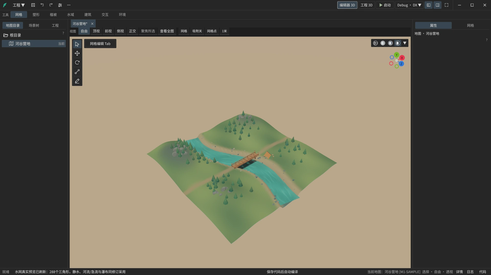
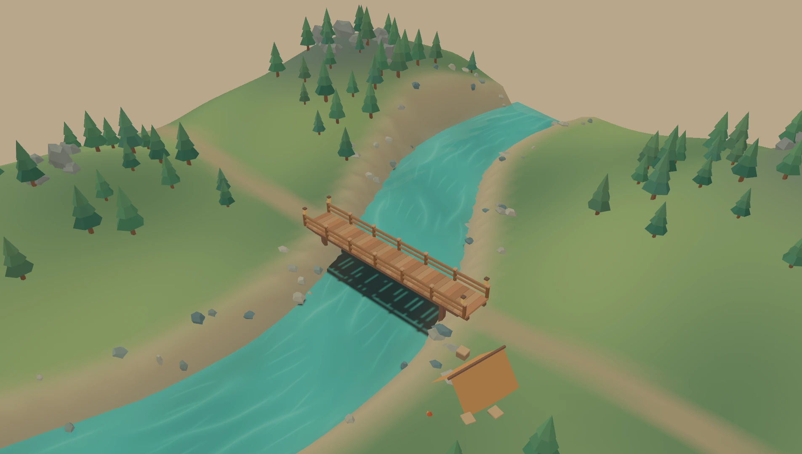

# Feathrise（羽立）

**面向大场景与快速迭代的高性能 Bevy 3D 编辑器。**

Feathrise（羽立）把场景制作、工程预览和 Rust 开发放进同一个开源工作台，面向用 Bevy 构建 3D 工程的开发者和内容作者。

[**下载 Windows 预览版**](https://github.com/feathrise/feathrise/releases) · [快速开始](#快速开始) · [使用说明](docs/使用说明.md)



*河谷营地演示工程的工作台实拍，展示地形、林带、样条河流和模型摆放。*

## 高性能地形、植被与水域

- **Geometry Clipmap 地形 LOD。** 相机附近保留精细地形，远处使用更粗的环带。稀疏高度页按需加载，显示与碰撞可分别设置 LOD。
- **局部体素地形（预览）。** 用三维笔刷挖掘、填充和平滑，制作洞穴、洞道与悬挑地形。密度数据分块存储，雕刻后只重建受影响的区域，近处显示精细网格，远处使用简化网格。
- **GPU 植被。** 用密度笔刷绘制草地和作物。草叶采用 GPU 实例化和四级 LOD，植被预设可配置随风摆动。
- **大规模树木与灌木。** 林带实例共享网格和材质，按距离切换模型细节。树位随相机移动保持稳定，近处实例可按预设启用碰撞。
- **动态水域。** 刷绘湖泊和池塘，用三维样条制作河流、急流和瀑布。水面几何在后台生成并分块上传，静水按地形裁出岸线，GPU 渲染波浪和交互波纹。



*同一座木桥在工程运行时的画面。* [观看 12 秒场景短片](docs/media/riverbend-tour.webp)

## 光追、DLSS 与 FSR

- **Bevy Solari 混合光追。** 在兼容的 Vulkan 设备上，为接入的地形和静态几何提供实时光照，并与光栅画面合成。
- **NVIDIA DLSS。** 通过可选特性接入超分辨率、光线重建（Ray Reconstruction）和 2× 帧生成。
- **AMD FSR（实验）。** FSR 3 超分辨率与 FSR 3.1 帧生成可分别启用。

Windows 单文件预览版编入 `raytracing`。DLSS 与 FSR 通过 Cargo 特性按需构建，实际可用性取决于显卡、驱动和对应的厂商组件。 [SDK 构建与运行条件](https://github.com/feathrise/feathrise_runtime#构建与运行前提)

## 更高效的 Rust 开发方式

- **编辑草稿，直接预览。** 兼容工程的「工程 3D」就绪后，可在同一运行世界预览当前未保存的场景改动。返回编辑时保留选择、相机和撤销历史。已保存的场景也可以从「编辑器 3D」独立启动。
- **保存源码，后台编译。** 在工作台或外部 IDE 保存代码后，由 DX（Dioxus CLI）或原生 Cargo 构建。点击诊断可跳转到源码行列，构建成功后由开发者确认应用新版本。模型和贴图改动走资源热重载。
- **保留运行状态调参数。** 兼容的 Debug 工程使用 DX 时，可在编辑态为显式登记的无参纯数值函数应用函数体补丁，保留当前运行状态。结构或依赖改动走完整构建，确认应用后重启工程预览。
- **扩展和交付自己的工程。** 在工作台导入 GLB、编辑材质和动画，按需加载原生作者插件。工程逻辑使用 Rust 和 Feathrise SDK 编写，Windows 下可导出独立运行目录。

## 快速开始

1. 从 [GitHub Releases](https://github.com/feathrise/feathrise/releases) 下载 Windows x86_64 单文件 EXE，双击打开。
2. 新建工程，在地图目录创建一张地图，然后使用「当前地图设为启动地图」。
3. 保存场景，在「编辑器 3D」点击「启动」，用模板提供的自由相机查看场景。

新建工程从空内容开始。首次获取工程依赖需要联网，编译工程需要 Rust/Cargo、MSVC 构建工具与 Windows SDK。

## 从源码启动

需要 Rust/Cargo；Windows 还需要 MSVC x64/x86 工具与 Windows SDK。链接器使用现有 Rust 工具链中的 `rust-lld`。

SDK 0.1.0 已发布。独立检出本编辑器后，在 `feathrise/` 使用随仓提供的[公开依赖配置](.cargo/registry-sdk.toml)：

```powershell
# 首次从源码覆盖切换到 registry 时，生成与公开来源对应的锁文件。
cargo --config .cargo/registry-sdk.toml fetch
cargo --config .cargo/registry-sdk.toml run --locked
```

SDK 由 crates.io 提供，八项渲染补丁由 Cargo 从固定 Git 提交取得。此入口用于没有 `.cargo/local-sdk.toml` 的独立检出；本机联调配置与公开配置分别使用，避免混合两种补丁来源。

新建工程默认使用 crates.io SDK `=0.1.0` 与固定公开补丁，不依赖编辑器旁边的源码目录。源码根或 EXE 旁的 `sdk-source.toml` 默认已经配置为：

```toml
[source]
kind = "registry"
version = "0.1.0"
git = "https://github.com/feathrise/feathrise_patches.git"
rev = "3c251d3530980b66e49b4748769db36ae9c6bd5a"
```

文件顶层保留 `format = 1`。外置配置缺失时使用程序内嵌的默认配方；配置存在但不可读或格式错误时明确报错。此设置只影响之后新建的工程；已有工程继续使用各自的清单和锁文件。

### 本地源码联调

需要同时修改 SDK 时，将本仓库检出到 `feathrise/`，在其父目录执行：

```powershell
git clone https://github.com/feathrise/feathrise_runtime.git
git -C feathrise_runtime checkout --detach 3dd0b6494a33da9f6851e0595dd1a36104f3beab
git clone https://github.com/feathrise/feathrise_patches.git
git -C feathrise_patches checkout --detach 3c251d3530980b66e49b4748769db36ae9c6bd5a
```

三个目录保持同级：

```text
feathrise/
feathrise_runtime/
feathrise_patches/
```

将[完整的 31 项本地覆盖配置](docs/开发与验收.md#本地源码覆盖)保存为编辑器目录下的 `.cargo/local-sdk.toml`。编辑器自己的 Cargo 配置会读取它；此文件已忽略，不需要其他父仓库配置。保持三个目录的相对位置即可整体搬移。

进入 `feathrise/`，首次获取锁定依赖后启动：

```powershell
cargo fetch --locked
cargo run --locked
```

`.cargo/local-sdk.toml` 负责编辑器本身的编译依赖；新建工程仍默认使用公开 SDK。需要让之后新建的工程也参与本地联调时，显式将 `sdk-source.toml` 的 `[source]` 改为 `kind = "path"`、`path = "../feathrise_runtime"`、`patch_path = "../feathrise_patches"`。这会在生成工程中记录本机绝对路径。[Windows CI](docs/ci.md)分别检查固定修订的源码联调与已发布 SDK 的 registry 消费，两种来源均覆盖默认与 validation 组合。

开发产物为 `target/debug/feathrise.exe`，内部 Cargo 包名为 `feathrise_host`。普通用户可使用编译好的编辑器；创建和运行工程仍需要工程所用的 Rust/Cargo 环境。

当前公开源码不提供 Feathrise 正式 Logo，默认构建无需品牌文件。需要使用自己有权使用的品牌素材时，见[可选自有品牌构建](docs/开发与验收.md#可选自有品牌构建)。

地形 GLB 保存默认不调用 Blender，不生成或改写同名 `.blend`。需要同步时，显式配置外部工具目录，见[可选 Blender 地形同步](docs/开发与验收.md#可选-blender-地形同步)；普通构建不包含这两份 Python 脚本。

## 使用与开发

- [使用说明](docs/使用说明.md)：双模式视口、工程运行与导出、SDK 来源和资源位置。
- [作者插件](docs/作者插件.md)：单文件插件、全局／工程安装及作者 ABI。
- [开发与验收](docs/开发与验收.md)：依赖配置、中性回归和可选外部验收适配器。
- [Windows CI](docs/ci.md)：固定 SDK 修订及默认与 validation 检查。

## 源码结构

```text
src/                宿主、工程管理、作者装配与运行进程生命周期
crates/             作者工具、插件 API 及工程管理库
assets/             内嵌工具图标、空工程模板与链接代理源码
build/              运行资源清单
tests/fixtures/     中性测试素材
docs/               使用、开发与 CI 文档
```

`build.rs` 与 `build/` 是编译输入；`Cargo.lock` 随编辑器源码维护。构建缓存 `target/`、本地验收产物 `.local/` 和本机依赖覆盖均已忽略。

自有源码、工具图标和测试素材采用 [MIT](LICENSE-MIT) 或 [Apache-2.0](LICENSE-APACHE) 双许可，可任选其一。Feathrise 正式 Logo 不在该双许可授权范围内。品牌使用条件与第三方归属见 [THIRD_PARTY_NOTICES.md](THIRD_PARTY_NOTICES.md)。
