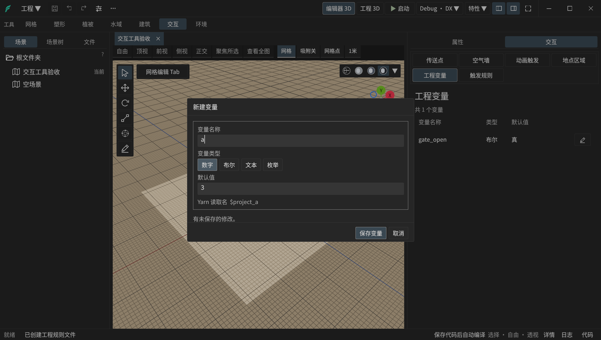
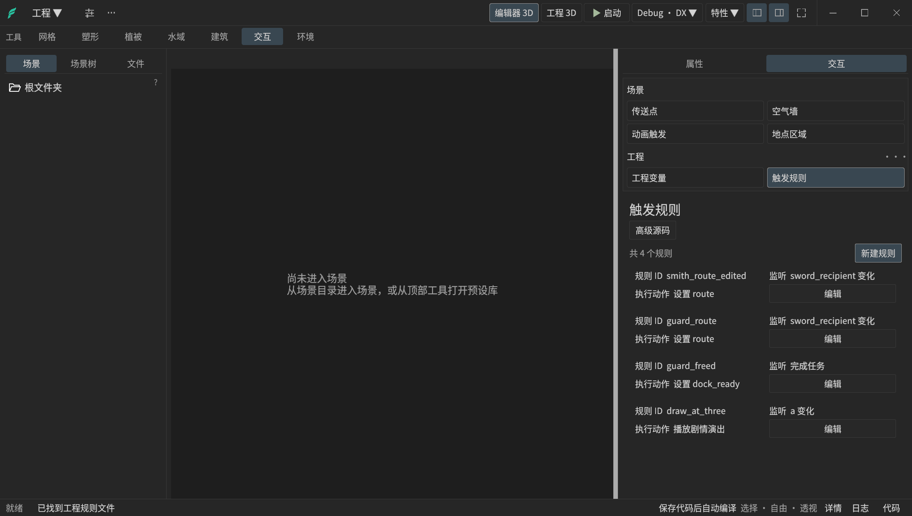

# 使用说明

## 工程与双模式视口

开始页提供新建、打开和最近工程。打开接受工程目录、`feathrise.toml` 或已有的 `editor-project.json`。默认工程目录初始为 `~/feathrise`，修改设置不会搬移已有工程。

在最近工程中用“固定工程”把常用工程留在列表顶部，再次启动时会恢复固定状态。多个工程同名时，可按名称旁的目录后缀和下方的完整路径区分。

新建工程没有示例场景、角色、装备、技能或界面。初始视角可选斜向或俯视，模板提供自由相机；工程自行接入其他控制器与内容。

左侧从上方页签切换「场景」「场景树」「工程」。在「场景」中创建场景、管理文件夹或打开另一个场景。「场景树」显示当前已打开场景的对象，也可在其中引用工程内的其他场景作为子场景。「工程」浏览磁盘上的文件和资源。

工程资产根下的 `scenes/catalog.scene_catalog.json` 记录场景目录，各场景在 `scenes/<SceneId>/` 保存自己的清单和作者资产。通过「当前场景设为启动场景」保存到工程根的 `startup.scene.json`。预览与导出沿用对应的场景身份，启动项独立于编辑器打开的标签。

- **编辑器3D**：作者使用编辑器自己的 World；点击“启动”，独立运行已保存的工程。
- **工程3D**：显示工程常驻运行视口，采用完整作者草稿后，通过“预览／返回”在同一 World 中交接编辑和运行。

编辑器保存作者文档、撤销历史与显式保存责任。预览时收起编辑界面，返回后恢复编辑现场；运行实例崩溃后重新启动并采用当前完整草稿。打开、保存与运行不会自动改写既有工程的依赖、入口源码或控制器。

自定义运行系统需加入 SDK 的 `ProjectGameplay` 集合或使用 `project_simulation_active` 条件，跟随编辑／运行暂停与恢复。草稿同步和常驻方式要求工程 SDK 支持相应通信合同。

工程3D启动编译期间，“预览”显示为“停止编译”；点击它或“编辑器3D”会请求取消。确认后台任务退出后恢复作者编辑，保留草稿；明确重选工程3D才重新编译。

在 Debug／Release 右侧打开「特性」，可勾选当前工程 `Cargo.toml` 中声明的可选特性，再点击「应用」。`default` 置顶并初始勾选，组内特性会联动勾选并标明来源。取消默认组时，手动勾选的特性继续保留。列表超过窗口半高范围时可以用右侧滚动条拖动。取消勾选并应用后，工程构建传入 `--no-default-features`。`raytracing` 等特性由工程默认组和显式勾选决定。选择按工程保存，供工程 3D、独立启动和源码自动编译使用。已有工程 3D 在编辑态切换时会用新特性重建，作者草稿和历史保留。

编译前可在顶栏的构建配置下拉选择“检查构建环境”，然后在工程日志查看实际采用的 Cargo、Rust 工具链、DX 来源和适用的缺失工具。

Windows 上若 Feathrise 当前的 PATH 找不到 Rust 构建工具，会继续检查 Windows 当前登记的 PATH 和 Rustup 安装目录。新建、构建或环境检查仍找不到所需工具时，安装提示可打开 [Rust 官方安装页](https://rust-lang.org/tools/install/)。安装完成后重试原操作。

打开工程日志后，按 Ctrl+F 或点击“查找”，输入 `warning` 或 crate 名即可查看高亮与匹配计数。查找框支持 Ctrl+C 和 Ctrl+V，日志正文支持 Ctrl+C 复制选中内容。“上一处”和“下一处”会跳到命中位置并暂停跟随。

## 在场景树添加 GLB

在左侧「场景树」的空白处或外层文件夹上右键，点「选择已有 GLB」。在文件选择窗口选中工程里的模型并确认，实例会加入相应的场景树层级。选中实例后，可在「属性」调整位置、旋转和缩放。要引用另一个完整场景，在左侧「场景」列表单选目标，再在右侧属性点击「添加为子场景」。

## 复制场景

在左侧「场景」列表右键选择「复制为新场景…」。填写名称并确认，完成后双击列表里选中的副本即可打开。源场景有草稿时，可以选「保存并复制」或「复制已保存版本」。后一种方式会保留原草稿。

副本有自己的场景 ID 和私有数据。模型、贴图和动作等工程公共资产继续共享。主 `scene.glb` 内的场景动画随场景单独复制。在父场景中选中副本目录行，可从右侧属性点「添加为子场景」。

## 制作界面布局

在左侧「文件」浏览工程资产目录，在目标文件夹右键选择「新建 → 界面布局（.rs）」。输入文件名并确认后，中央会打开新建的空白界面。产物是包含原生 `bsn!` 的普通 Rust 模块，只依赖 Bevy；工程可引入该模块，并调用 `ui_scene` 创建界面。双击已有的界面 `.rs` 可继续编辑，旧 `.bsn` 仍可打开和保存。

用左侧控件库添加容器、文本、图片、按钮或数据绑定。从层级或画布选中控件，拖动调整位置，或者修改右侧属性后点「应用属性」。保存、撤销、重做使用编辑器顶部公共按钮，画布和源码共用当前文件的草稿与历史；通过「源码」可查看并修改同一个文件。「编辑」与「交互预览」相邻成组，尺寸和窄屏选项位于旁边；切换模式不会修改文件。「交互预览」可以试点按钮并显示动作 ID。数据绑定在画布上显示 ID，实际值由运行工程提供。

界面 `.rs` 的首行保留 `// feathrise-ui: editable`，编辑器据此开启画布。普通 Rust 源码沿用文本编辑。源码模式可直接修改受支持的 `bsn!` 布局，回到预览后重新读取；画布修改只替换该宏的正文，保留宏外的导入、函数和手写业务代码。宏内出现画布无法理解的组件或表达式时会显示诊断，请在源码中修改。每个可编辑文件包含一个 `bsn!` 场景；多个场景可分别保存为模块。

## 工程变量与触发规则

打开顶部「交互」。右侧目录第一行是「传送点」「空气墙」「动画触发」「地点区域」，第二行是「工程变量」「触发规则」。拖动侧栏只改变按钮宽度，六项的位置固定。点任一工具只更换下方正文，中央保持当前场景或文档。[中央文档与交互目录实窗](media/interaction-tool-directory.png)

地点区域、工程变量与触发规则共用主资产根的 `project_rules.json`，文件不存在时会创建空白配置。地点表单在切回工具后可以继续填写，再用「保存地点」写入文件。从文件浏览器双击配置可在中央查看和编辑 JSON。

**添加第一个变量**

1. 在「交互」点「工程变量」，再点列表上的「新建变量」。在对话框的「变量名称」里填 `a`，下方会显示 Yarn 读取名 `$project_a`。
2. 新变量默认选中 `number`。把「值」从 `0` 改成 `3`。记录开关请选择 `bool`，值可选 `true` 或 `false`。自由输入用 `text`。取值固定时用 `enum`，用逗号分隔选项，再从中选择或填写一个值。
3. 点「保存变量」。底部信息栏显示 `变量「a」已保存` 后，在单行记录中核对名称、类型和值。点行尾的铅笔打开编辑对话框，点「取消」放弃当前填写。点铅笔后的垃圾桶可删除该变量，编辑器会先校验规则是否仍引用它，写盘成功后再移除对应行。



工程启动时，由支持工程规则的运行时 SDK 读取已保存的文件。改动保存后重新启动工程即可采用。工程的玩法插件负责将 Yarn 的 `$project_` 变量接到规则库、注册道具命令，并消费 `quest.start` 等领域请求。配套 RPG 工程已接入这三项。

示例中的 `sword_recipient` 记录接收人，`route` 记录路线。在接入变量桥接的 Yarn 对白中执行 `<<set $project_sword_recipient = "smith">>` 后，铁匠分支会检查 `route` 是否为 0，然后把它改成 1 并请求启动 `smith_delivery` 任务。将去向设为 `"guard"`，守卫分支会把 `route` 改成 2 并请求启动 `guard_delivery`。示例使用 `once` 让每条分支只执行一次。[送剑分支完整示例](../crates/feathrise_editor_documents_model/src/project_rules/example.json)

在接入 RPG 道具命令的工程里，可以用 `<<give_tracked_item "家传剑" "sword_item">>` 发放真实物品，示例的 `sword_item` 初值为空字符串，发放成功后存放物品实例 ID。在铁匠的 Yarn 节点执行 `<<deliver_item "{$project_sword_item}" "village" "smith" "sword_recipient" "none">>`，成功交付时会取走这件物品并将去向设为 `smith`。守卫节点将接收点位改为 `guard`。请将示例的地图、NPC 点位和任务 ID 替换成工程已登记的实际 ID。

**让变量变化触发演出**　先将 `a` 的「值」设为 `0` 并保存。在「交互 → 触发规则」点「新建规则」。在对话框里填写规则 ID，监听选「变量变化」。「变化变量」选 `a`，打开「限定新值」，填 `3`。在「动作类型」点「播放剧情演出」，在「演出 ID」里填工程已有的演出，例如 `draw-river-sword`，再点「保存规则」。需要只看一次时，开启「每个存档仅一次」。游戏中执行 `<<set $project_a = 3>>` 会改变当前存档的值，其他 Yarn 节点可用 `<<if $project_a == 3>>` 进入对应分支。

每条规则单行显示 ID、监听和执行动作。点行尾的铅笔打开编辑对话框，点垃圾桶删除该条规则并保存。在规则中可追加条件、按顺序追加动作，或用「动作上移」「动作下移」调整顺序。保存会检查变量引用、取值、规则 ID、条件和动作。根据字段提示修正后可继续保存。



**用地点触发规则**　在「交互 → 地点区域」点「新建地点」，地点 ID 可填 `east_gate`，场景 ID 填工程已有的场景。可以手填最小坐标 `0, 0, 0` 和最大坐标 `4, 3, 6`。也可以手动切到对应场景，填好底部和顶部的 Y 值，点「在视口绘制范围」，依次点击地面上的两个对角。坐标会回填到右栏，核对范围后点「保存地点」。每一轴的最小值须小于最大值。

回到「触发规则」新建规则，监听「游戏事件」，在「事件名称」旁点「选择… → 进入地点」，将「事件目标」设为 `east_gate`，再配置动作并保存。选择「离开地点」可在走出同一范围时触发。

## 制作剧情演出

在「文件」页进入工程的 `assets` 目录或它的子目录，右键空白处，选择「新建 → 剧情演出」。新文件自动打开。下次双击 `.cinematic.json` 可回到四轨工作台。先打开要观察的场景，再在「演出设置」里填写名称、总时长和接管镜头／玩家的选项。

| 轨道 | 作者操作 |
| --- | --- |
| 镜头 | 进入透视视口，用右键旋转、中键平移、滚轮缩放。填写时间，点「记录视口机位」。可单独填写位置、旋转、缩放和垂直视角。「平滑」控制抵达这个键时的过渡，关闭后在该键时刻切镜。 |
| 角色 | 目标填写 `player` 或角色点位及槽号，例如 `city_guard#0`。选「变换」记录走位、朝向和缩放，或选「已有动作」填写动作名和时长。「选择已有动作…」可从工程模型的真实动画列表取名。 |
| 物件 | 填写场景中的稳定摆放 ID，也可以点「采用所选物件」。按需要录入变换或模型已有的动作。在多实例场景中可填写完整实例路径。 |
| 对白 | 选择「字幕」填写正文，或选择「Yarn 节点」填写工程中已有的节点名，再设置起始时间和时长。启用「等待对白」可让游戏等待对白完成。 |

按「新增」落下当前属性，点标记或用「上一项／下一项」选取，再用「更新选中」或「删除选中」修改。左右拖动键或片段可以调整开始时间，释放鼠标后可单笔撤销。点击或拖动时间尺、输入秒数后点「定位时间」，均可查看中段画面。「播放／暂停」从游标继续，「退出试播」归还场景视口。工程 3D 预览使用实际场景及工程注册的演员。本地视口可以检查机位、场景摆放和字幕。试播、拖帧和导出均不写入任务或已看进度。

点「保存」写入演出文件。要设置重复播放、任务阶段等条件或结束动作，点「高级源码」编辑同一文档，点「预览」返回时间线。在当前演出的时间线点「绑定触发规则…」，填写事件名和目标，例如 `location.entered` 和工程已有的地点 ID，点「创建触发规则」。右侧「交互 → 触发规则」展开新规则，中央保留当前演出。核对事件、目标和演出 ID 后点「保存规则」。游戏启动时读取配置，任务与 Yarn 事件由工程的玩法插件发布。需要制作宣传片时，在保存后的四轨工具栏点「导出视频…」。

在导出面板确认输出 `.mp4`、尺寸和帧率。场景 ID 默认取当前已打开的场景，留空时使用工程开局。需要填写对白停留、子场景实例、配乐或 FFmpeg 路径时，打开「高级设置」。遇到未指定的 Yarn 选择时，直接点要拍摄的选项。已有同名影片时可以修改文件名，或明确允许覆盖。导出中可点「取消导出」或按 Esc，取消时保留原文件。

## SDK 来源

新建场景工程可读取源码根或 EXE 旁的 `sdk-source.toml`。默认直接使用模板的 Cargo 清单和锁。源码版读取[公开空模板](../templates/empty/Cargo.toml)的固定 Git 提交，单 EXE 读取打包时写入的模板。首次构建时由 Cargo 获取缺少的依赖，需要本机 Rust、MSVC 与 Windows SDK。

联调时可将 [本地来源示例](../sdk-source.local.example.toml) 复制为 `sdk-source.toml`，显式选择下面的同级源码路径。本地来源核对实际场景包身份及 Bevy 0.20.1 兼容性。

```toml
format = 1
[source]
kind = "path"
path = "../feathrise_runtime"
patch_path = "../feathrise_patches"
```

本地相对路径以配置文件所在目录为准，生成工程记录实际绝对路径。选用 `kind = "git"` 时，通过 `git` 和完整 `rev` 选择场景 SDK 源码，`patch_git` 和 `patch_rev` 指定独立补丁仓。显式 `kind = "registry"` 需要选择已发布的场景版 SDK 和对应补丁。

新建时保留种子锁的兼容版本，再执行 `cargo fetch`。path 来源使用离线缓存，Git 和 registry 来源允许联网。不可读或损坏的配置会报告错误。新版场景工程使用自身的 Cargo 清单和锁文件运行。

## 工程导出

Windows 下通过“工程 → 导出工程…”生成独立运行文件夹，默认目录为当前工程的 `output/`，也可另选目录。导出沿用当前 Debug／Release 配置，复制已保存的构建结果、场景及登记资产；未保存草稿继续留在编辑器。

完成后可将整个文件夹搬移运行。标准 Windows MSVC 导出静态链接 C 运行库，并核对程序和随包 DLL 的普通及延迟导入。目标机器免装 VC Redist，需有适用的图形驱动。显式启用 DLSS 或 FSR 帧生成的构建沿用各自的原生运行库要求。工程需要 v2 描述清单和 `saved-world v1` 入口。取消或链接检查失败时保留原有效包。

## 在 Blender 编辑单个网格

在场景树右击立方体、平面、内置编辑网格或普通完整 GLB 摆放，选择「在 Blender 编辑」。Blender 按个人偏好打开这个模型。按 `Ctrl+S` 保存后，Feathrise 自动加载导出的 GLB 并更新原对象。模型的节点变换随 GLB 显示，场景中的摆放由 Feathrise 管理。回显可撤销。保存场景时会一并记住新的模型引用。

回传结果是普通 GLB 模型，继承原来摆放的碰撞开关。选中场景树的完整对象，在右侧「属性」切换碰撞，保存场景后根据模型的实际表面生效。已有回填模型未设置碰撞时显示关闭。

再次编辑会打开 Feathrise 当前使用的模型。临时 `.blend` 随会话清理，需要以后继续编辑 Blender 的修改器或几何节点参数时，可以另存源稿。

安装本机 Blender 后，公开源码构建和官方 Windows 单 EXE 都可直接使用「在 Blender 编辑」和 Blender 绑骨。两处自动加载 Feathrise 内置的同一份导出器，脚本只在当前会话生效，无需在 Blender 里安装插件。更新 Feathrise 后，新会话默认使用对应版本的导出器。

Blender 安装在其他位置时，可在「设置 → 常规 → Blender 程序」中选择 `blender.exe`。路径会记住，供「在 Blender 编辑」和 Blender 绑骨共用。点击「自动查找」会清除手动路径，并显示找到的 Blender 完整路径。启动时设置的 `BEVY_LEARN5_BLENDER_PATH` 优先于个人设置。

保存地形时，编辑器直接写入 GLB。

## 资源与可写目录

工具图标、空工程模板、种子锁和链接代理源码编译内嵌；中文字体由 SDK 的 `default_font` 提供，工程可显式指定自己的字体。品牌图片与 Windows 图标仅在构建时显式提供品牌目录后内嵌。

移动后的程序在窗口创建前校验并释放资源到 `%LOCALAPPDATA%/Feathrise/resources/<摘要>/`；资源缓存不含 SDK 来源配置或用户工程。`FEATHRISE_EDITOR_ROOT` 可显式指定外置资源根，仍需通过完整校验。

编辑器自身编译使用自身的 `target/`。从编辑器打开、启动或预览工程时，工程构建默认使用该工程根目录的 `target/`，热更新与导出沿用同一个目录；不同工程各自保存编译产物。需要自选缓存时，显式 `--target-dir` 优先于 `CARGO_TARGET_DIR`，覆盖在启动时固定为绝对路径。已有缓存原位保留，工程保存、租约和事务文件仍留在工程内。

个人配置与全局插件统一放在当前用户主目录的 `.feathrise/`：

```text
~/.feathrise/editor.json         默认工程目录、最近工程和 Windows 主窗口状态
~/.feathrise/editor.author.json  作者界面偏好
~/.feathrise/plugins/            全局作者插件
```

Windows 的 `~` 对应当前用户目录，例如 `C:\Users\<用户名>`。新配置不存在时，会从旧 `%APPDATA%/Feathrise/` 复制相应文件；原先使用 `~/.config/feathrise/` 的配置也保留迁移兼容。新文件存在时以新位置为准，旧文件保留为备份。主窗口与作者配置分别迁移，坏配置明确报错并保持只读，不用空默认值覆盖旧记录。

显式指定 `FEATHRISE_PREFERENCES_FILE` 时使用该文件，作者偏好跟随其同名 `.author.json`；这种自定义或验收配置不读取旧用户目录。默认工程存放目录仍由设置控制，初始为 `~/feathrise`。

Windows 上正常退出 Feathrise 后，下次打开会恢复主窗口的大小、位置和最大化状态。副屏断开或分辨率变化后，越界的窗口会移回可见的显示器工作区。

内嵌资源不取消运行库要求：开发程序可能依赖 Bevy/Rust 动态库，Windows 需要相应 MSVC 运行库；所选 FSR／DLSS 特性也可能需要自己的运行组件。
